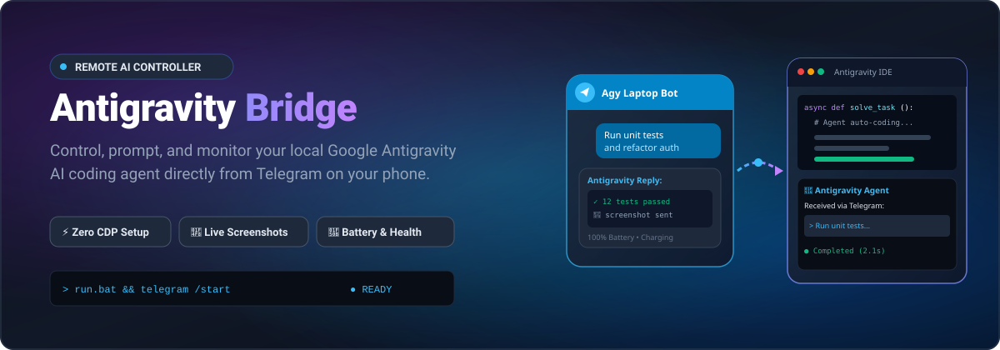

<p align="center">
  
</p>

<p align="center">
  <strong>Control and monitor Google Antigravity IDE on your laptop remotely from your smartphone via Telegram.</strong>
</p>

<p align="center">
  <a href="https://www.python.org/"></a>
  <a href="https://microsoft.com/windows"></a>
  <a href="https://core.telegram.org/bots/api"></a>
  <a href="LICENSE"></a>
</p>

<p align="center">
  <a href="#english">🇬🇧 English</a> •
  <a href="#russian">🇷🇺 Русский</a> •
  <a href="#features">✨ Features</a> •
  <a href="#quick-start">🚀 Quick Start</a> •
  <a href="#comparison">⚖️ Comparison</a> •
  <a href="#roadmap">🗺️ Roadmap</a>
</p>

---

<a name="english"></a>
## 🇬🇧 English Overview

**Antigravity Remote Bridge** is a lightweight, zero-configuration gateway that connects your smartphone to **Google Antigravity IDE** on your Windows laptop.

Step away from your desk while your agent is coding: send prompts, receive live screenshot feedback of generated code, check your laptop's battery and CPU load, and execute shell diagnostics — all through a private, secured Telegram bot.

<a name="features"></a>
### ✨ Key Features

* 📱 **Remote Prompting:** Type code, instructions, or refactoring tasks on your phone; the bridge brings Antigravity to the foreground, pastes via Unicode clipboard, and presses Enter.
* 📸 **Live Screenshot Feedback:** Automatically captures your laptop's screen after sending a prompt and replies with an image in Telegram so you see the agent's work in real time.
* 🔋 **Laptop Health Monitoring (`/status`):** Monitor battery charge percentage, AC power status, CPU usage, RAM utilization, and free disk space.
* 🔒 **Zero-Config Security:** Automatically claims the first user who executes `/start` as the laptop owner. Unauthorized users are blocked by a strict Telegram User ID allowlist.
* ⚡ **Firewall & NAT Friendly:** Works on any Wi-Fi or mobile network using outbound Telegram Long Polling — no static IP, port-forwarding, or ngrok required.

<a name="comparison"></a>
### ⚖️ Why Antigravity Remote Bridge?

| Feature | Heavy CDP Tools (Remoat, TelGravity) | **Antigravity Remote Bridge** |
| :--- | :--- | :--- |
| **Setup Complexity** | Requires `--remote-debugging-port`, CDP configs, Node.js | **1-Click:** Run `run.bat` on native Python |
| **Input Method** | Browser automation hooks (CDP / DOM) | **Native Win32 Clipboard:** Full Unicode & Emoji support |
| **Dependencies** | Heavy Node.js/Playwright bundle (>150 MB) | **Ultra-lightweight:** ~300 lines of clean Python |
| **Laptop Telemetry** | ❌ None (Chat only) | **✅ Battery, AC power, CPU, RAM, Disk** |
| **Closed-Lid Friendly** | Varies | **✅ Tailored for closed-lid laptops** |

<a name="quick-start"></a>
### 🚀 3-Minute Quick Start

```text
📱 Smartphone (Telegram) ──[Long Polling]──▶ 💻 Laptop (run.bat) ────▶ 🤖 Antigravity IDE
```

#### 1. Create your Telegram Bot
1. Open [@BotFather](https://t.me/BotFather) on Telegram and send `/newbot`.
2. Follow prompts to name your bot and copy the **HTTP API Token** (e.g. `123456789:ABCdefGhIJK...`).

#### 2. Configure
Copy `config.example.json` to `config.json` and paste your token:
```json
{
  "telegram_bot_token": "YOUR_TELEGRAM_BOT_TOKEN_HERE",
  "allowed_chat_ids": [],
  "mode": "gui",
  "antigravity_window_title": "Antigravity",
  "auto_screenshot_after_send": true,
  "screenshot_delay_seconds": 2.0
}
```
*(Leave `allowed_chat_ids` as `[]` — the first person to message the bot will automatically be registered as the sole owner).*

#### 3. Run
Double-click **`run.bat`** (or execute `python bot.py`).  
Open your bot in Telegram on your phone and press **`/start`**!

---

### ⌨️ Command Reference

| Button / Command | Action |
| :--- | :--- |
| **Any text message** | Pastes text into the Antigravity chat input and submits (`Enter`). |
| **📷 Screen (`/screen`)** | Captures a live full-screen screenshot of your laptop. |
| **💻 Status (`/status`)** | Displays battery (%), charging state, CPU %, RAM %, and Disk C: space. |
| **🔄 Switch Mode (`/mode`)** | Toggles between `GUI` (IDE window) and `AGENT` (Python SDK). |
| **`/windows`** | Lists all detected Antigravity and IDE windows on the desktop. |
| **`/exec <command>`** | Executes a PowerShell command on the laptop and returns terminal output. |

---

<a name="russian"></a>
## 🇷🇺 Описание на русском

**Antigravity Remote Bridge** — легковесный мост для удаленного управления **Google Antigravity IDE** со смартфона через **Telegram**.

### ✨ Возможности

* 📱 **Удаленная отправка задач:** Любой текст или код со смартфона вставляется в активное окно Antigravity IDE и запускается нажатием `Enter`.
* 📸 **Скриншот ответа на телефон:** После отправки задачи бот делает снимок экрана и присылает фото прямо в диалог Telegram.
* 🔋 **Контроль батареи и железа (`/status`):** Мониторинг уровня заряда аккумулятора, питания от сети, загрузки процессора и оперативной памяти.
* 🔒 **Автоматическая безопасность:** Первый пользователь, написавший `/start`, автоматически фиксируется как единственный владелец. Посторонние запросы отклоняются.
* ⚡ **Работа за NAT и роутерами:** Бот слушает серверы Telegram через Long Polling — белый IP-адрес или проброс портов не требуются.

---

### 💡 Как настроить работу с закрытой крышкой

Чтобы ноутбук не засыпал, пока вы управляете им с телефона:
1. Нажмите `Win + R` → введите `control powercfg.cpl`.
2. В левой колонке нажмите **«Действие при закрытии крышки»**.
3. Для пункта **«При закрытии крышки: От сети»** установите **«Действие не требуется»**.

---

<a name="roadmap"></a>
## 🗺️ Roadmap & Planned Features

- [x] Native Win32 window focus & Unicode clipboard injection
- [x] Instant screenshot feedback
- [x] Laptop battery & hardware diagnostics
- [x] Zero-config Telegram ID authorization
- [ ] 🎙️ **Voice Prompts:** Send voice notes in Telegram and transcribe via Whisper / Gemini API
- [ ] 🔘 **Inline Approval Buttons:** One-tap `[Approve]` / `[Reject]` for Antigravity terminal execution dialogs
- [ ] 💬 **Discord & Slack Adapters:** Support additional messenger protocols

---

## 🤝 Contributing

Contributions, issues, and feature requests are welcome! Feel free to check the [issues page](https://github.com/TEMASHOOTER/antigravity-telegram-bridge/issues).

## 📄 License

This project is licensed under the **MIT License**. See the [LICENSE](LICENSE) file for details.
